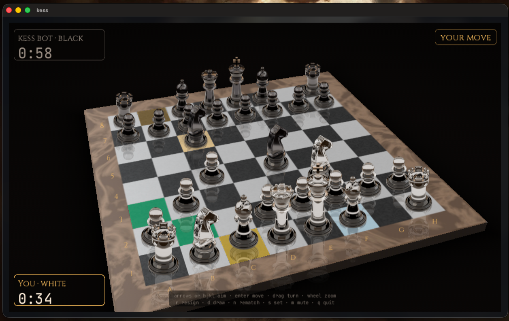
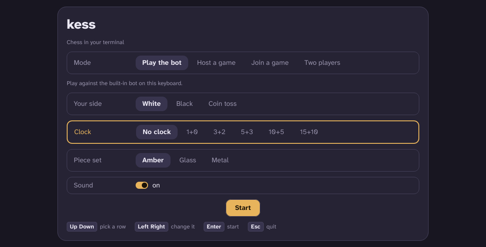
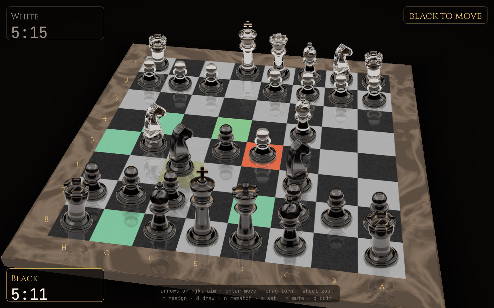
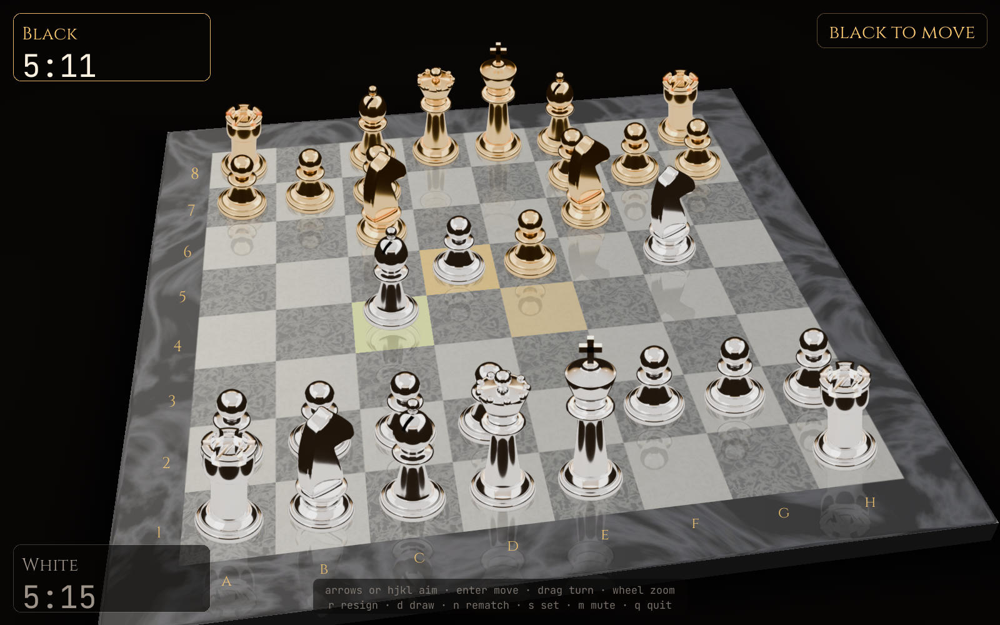
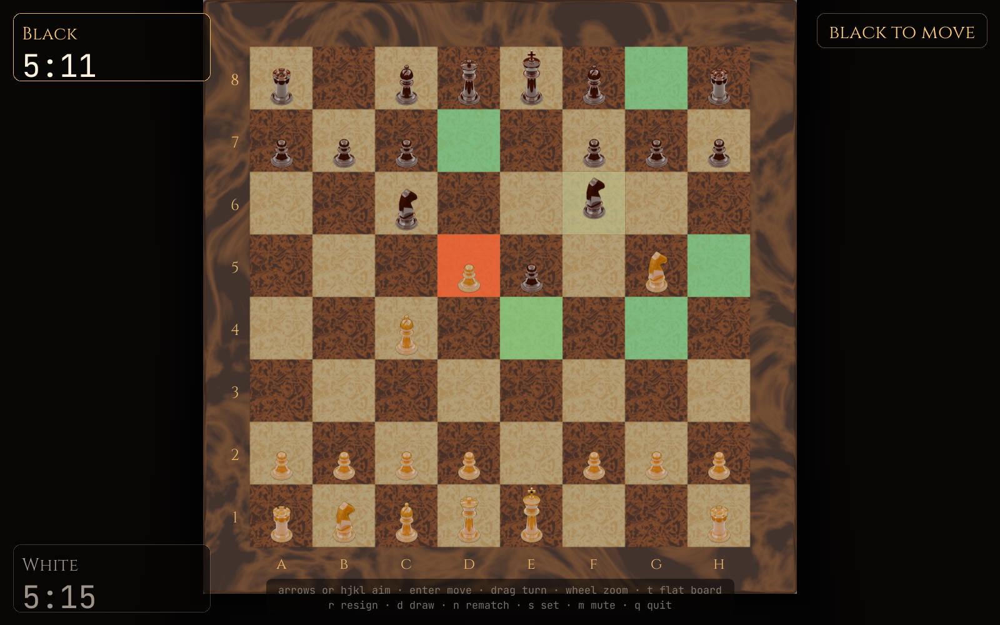
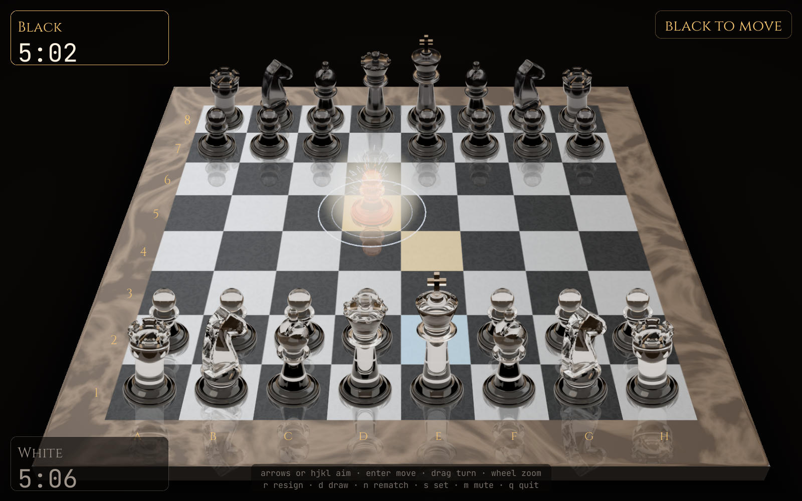

<h1 align="center">kess</h1>

<p align="center">
  Chess on a glossy 3D board in your terminal: against a bot, on one keyboard, or online with a code.
</p>

<p align="center">
  <a href="#install">Install</a> ·
  <a href="#play">Play</a> ·
  <a href="#features">Features</a> ·
  <a href="#keys">Keys</a> ·
  <a href="#how-online-play-works">How online play works</a> ·
  <a href="#build">Build</a> ·
  <a href="https://chat.h4ks.com">IRC</a>
</p>

<p align="center"></p>

kess is a chess game for the terminal that draws the board as an image, with
amber, glass and metal piece sets. You can play the built-in bot, a friend
on the same keyboard, or a friend online. Online play needs no account and
no server of your own, and the two players never see each other's IP
address.

## Install

kess runs on macOS and Linux, on x86_64 and arm64, and on Windows on
x86_64.

<details>
<summary><b>Homebrew</b> (macOS and Linux)</summary>

```sh
brew install h4ks-com/tap/kess
```

</details>

<details>
<summary><b>Scoop</b> (Windows)</summary>

```sh
scoop bucket add h4ks https://github.com/h4ks-com/scoop-bucket
scoop install h4ks/kess
```

</details>

<details>
<summary><b>cargo-binstall</b></summary>

```sh
cargo binstall --git https://github.com/h4ks-com/kess kess
```

</details>

<details>
<summary><b>Cargo</b> (builds from source)</summary>

```sh
cargo install --git https://github.com/h4ks-com/kess
```

On Linux this needs the packages under [Build](#build) first.

</details>

Prebuilt binaries are on the
[releases page](https://github.com/h4ks-com/kess/releases). On Windows,
unzip `kess-x86_64-pc-windows-msvc.zip` and run `kess.exe`.

kess looks like the screenshots in kitty, Ghostty and iTerm2. Terminals with
sixel graphics, such as WezTerm and foot, show a lower quality picture, and
the rest, such as Alacritty and Terminal.app, show one made of block
characters. On Windows, a
[WezTerm nightly](https://wezterm.org/install/windows.html) build shows the
full picture and Windows Terminal 1.22 or newer shows sixel.

## Play

Run `kess` and pick a game from the menu: play the bot, host an online game,
join one with a code, or "Two players", where two people take turns on one
keyboard. Move between rows
with the arrow keys, change a value with <kbd>←</kbd> <kbd>→</kbd>, and
press <kbd>Enter</kbd> to start.

<p align="center"></p>

Every menu choice also works as a command, to skip the menu:

```
kess bot black --clock 5+3    # play the bot as black, 5 minutes plus 3 seconds a move
kess local --set glass        # Two players, with the glass set
kess host white               # host an online game and get a code to share
kess join 7FQ2-K9XM-3TBW      # join a game with the host's code
```

## Features

### See where a piece can go

Click a piece, or move the highlight onto it and press <kbd>Enter</kbd>.
The squares it can reach light up: green to move there, red to take a
piece. Click one, or press <kbd>Enter</kbd> on it, to move.

<p align="center"></p>

### Turn the board

Drag anywhere to swing the board around and tilt it, and scroll to zoom.
Press <kbd>c</kbd> to put the camera back behind your side.

<p align="center"></p>

### See the board flat from above

Keep tilting the board up past its highest angle, or press <kbd>t</kbd>, and
it lays flat like a board in a 2D chess app, so every piece sits plainly on
its square. Tilt it back down or press <kbd>t</kbd> again for the 3D board.

<p align="center"></p>

### Effects and sound for captures, check and checkmate

A capture breaks the taken piece into sparks with a shockwave across the
board, check lights the king red, and checkmate ends the game with a banner
and fireworks. Each set sounds like its material: glass clinks, metal rings
and amber knocks. Press <kbd>m</kbd> to mute.

<p align="center"></p>

### Vi-like keys

<kbd>h</kbd> <kbd>j</kbd> <kbd>k</kbd> <kbd>l</kbd> work like the arrow
keys everywhere, in the menu and in a game, and <kbd>q</kbd> quits. You can
play a whole game without touching the mouse.

### Play online with a code

One player picks "Host a game" and gets a code like `7FQ2-K9XM-3TBW`. The
other picks "Join a game" and types it in, and the game starts. After a
game, both players press <kbd>n</kbd> for a rematch with the sides swapped.
If the joining player quits by accident, joining again with the same code
brings the game back. If the host quits, the game ends.

## Keys

| Key | Action |
|---|---|
| arrows or `h` `j` `k` `l` | move the highlight |
| `Enter` or `Space` | pick up a piece, then put it down |
| `Esc` or `Backspace` | put the piece back |
| `r`, then `y` | resign |
| `d` | offer a draw, or accept the one on the table |
| `n` | ask for a rematch after a game |
| `s` | switch between the amber, glass and metal sets |
| `c` | put the camera back behind your side |
| `t` | switch between the 3D board and a flat board seen from above |
| `f` | turn the board around, in Two players |
| `m` | mute or unmute |
| `q` or `Ctrl+C` | quit |

When a pawn promotes, pick the piece with <kbd>←</kbd> <kbd>→</kbd> and
press <kbd>Enter</kbd>.

## How online play works

The two players never connect to each other. Each one connects to two free
public MQTT brokers ([HiveMQ] and [EMQX]) over TLS, and kess sends every
message to both, so the game goes on if one of them is down. The brokers
see each player's IP address. The players don't see each other's.

kess turns the code into a room name and an encryption key, and encrypts
every message with ChaCha20-Poly1305. The brokers can't read or change the
game, but anyone with the code can, so share it only with your opponent.

Both players check every move on their own machine with the full rules of
chess, and they check each other's clock times too. kess refuses a forged
or illegal move.

The game ends on checkmate, stalemate, insufficient material, resignation,
a timeout or an agreed draw. It also ends by itself on fivefold repetition
and the 75-move rule. kess has no claim for threefold repetition or the
50-move rule, so offer a draw with `d` in those positions.

[HiveMQ]: https://www.hivemq.com/mqtt/public-mqtt-broker/
[EMQX]: https://www.emqx.com/en/mqtt/public-mqtt5-broker

## Build

kess needs Rust 1.90 or newer. If you don't have Rust yet, install it with
[rustup](https://rustup.rs) and load it into your shell, or run
`rustup update` for an older one:

```sh
curl --proto '=https' --tlsv1.2 -sSf https://sh.rustup.rs | sh
source ~/.cargo/env
```

On Linux, install a C compiler, pkg-config and the sound library:

```sh
sudo apt install build-essential pkg-config libasound2-dev    # Debian and Ubuntu
sudo dnf install gcc pkgconf-pkg-config alsa-lib-devel        # Fedora
sudo pacman -S base-devel pkgconf alsa-lib                     # Arch
```

Then build and install `kess` from a clone:

```sh
git clone https://github.com/h4ks-com/kess && cd kess
cargo install --path .
```

To build without sound, and without the Linux sound library, add
`--no-default-features`.

## Development

kess draws with [katui](https://github.com/h4ks-com/katui). The
[justfile](justfile) holds every command: `just ci` runs the checks CI
runs, `just test-online` plays a game through the real brokers, and
`just art` renders the boards and pieces again with Blender from
[assets/render.py](assets/render.py). [AGENTS.md](AGENTS.md) describes the
layout of the code.

## License

kess is licensed under the [GNU General Public License v3.0 or later](LICENSE).
It bundles the Cinzel and JetBrains Mono fonts, which are under the SIL Open
Font License ([Cinzel](assets/fonts/Cinzel-OFL.txt),
[JetBrains Mono](assets/fonts/JetBrainsMono-OFL.txt)).
